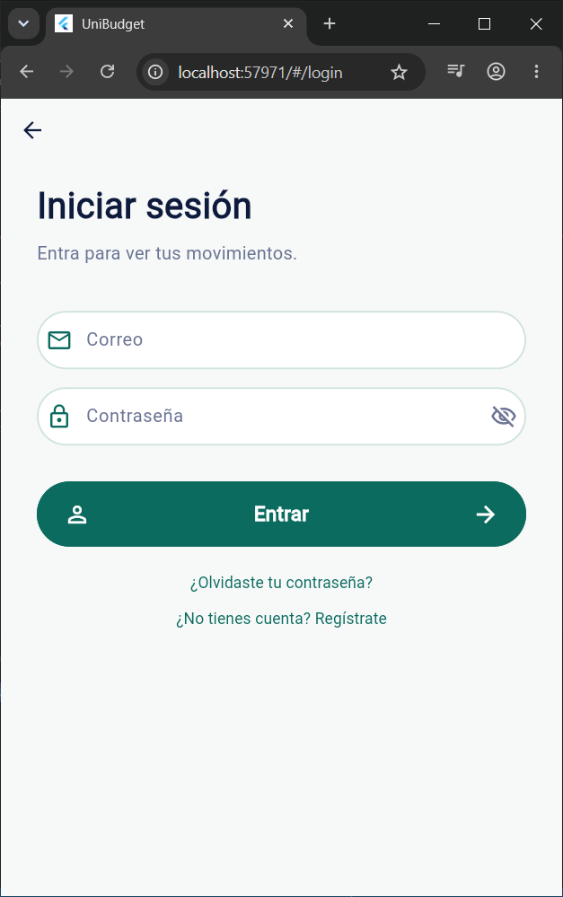
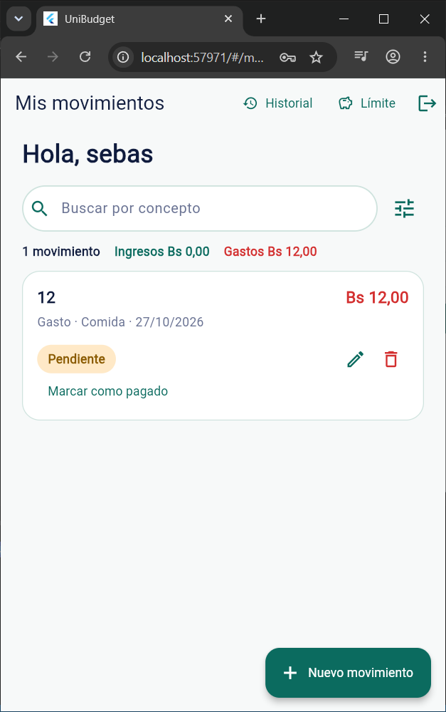
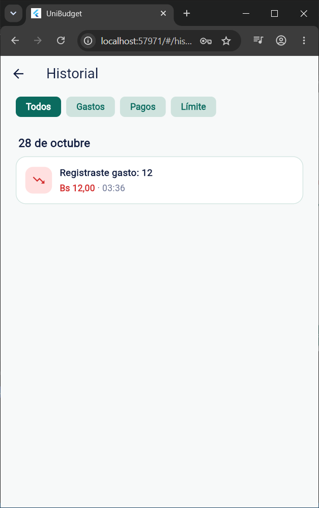
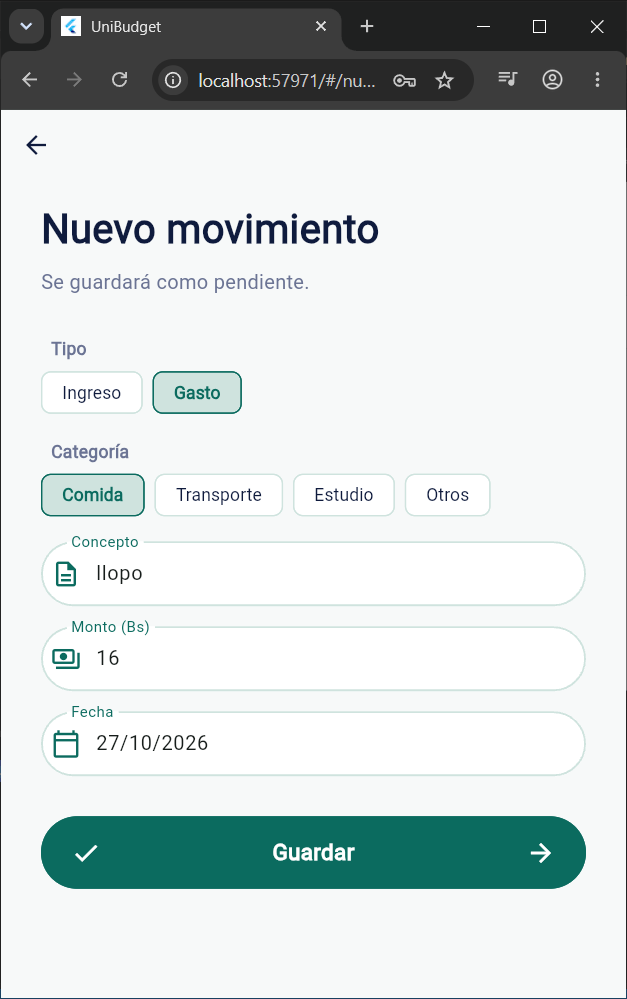

# Clase 17 — Código ajeno y refactoring

En ./pre_estudiantil.mp4 esta la prueba de que se corrio el proyecto con éxito.

> **Principio de la clase:** Primero entender. Después cambiar.

---

## 1. Proyecto recibido

- **Grupo anterior:** UniBudget 

- **Repositorio:** https://github.com/ary10220/Pre_estudiantil

**Descripción:**
UniBudget es una app móvil para que estudiantes registren y organicen sus ingresos y gastos personales. Permite crear movimientos (gastos e ingresos), marcarlos como pagados/cobrados, editarlos y eliminarlos, definir un límite mensual de gastos con alerta de progreso, y consultar un historial de actividad agrupado por día con filtros por tipo de evento. El stack es **Flutter/Dart** en el cliente, **Node.js + Express** en el backend y **PostgreSQL** como base de datos.

---

## 2. Ejecución

### Prerrequisitos

| Herramienta | Versión mínima |
|---|---|
| Flutter + Dart | SDK `^3.13.1` |
| Android Studio | Con emulador Pixel 6a (u otro Android) encendido |
| Node.js | v18 o superior |
| PostgreSQL | Cualquier versión reciente |

### Pasos

#### 1. Base de datos

En pgAdmin o `psql`, crear la base y el esquema completo:

```sql
CREATE DATABASE presupuesto_estudiantil;
```

Conectarse a esa base y ejecutar `base_datos/esquema.sql`. Si la base ya existía con un esquema anterior, aplicar los scripts de `base_datos/cambios/` en orden:
`001_limite_mensual.sql` → `002_limites_mensuales.sql` → `003_tipo_categoria.sql` → `004_eventos.sql`.

#### 2. Servidor (API)

```powershell
cd servidor
copy .env.example .env
```

Abrir `servidor/.env` y completar `DB_PASSWORD` con la contraseña de PostgreSQL. Las demás variables no suelen cambiar:

```
DB_HOST=localhost
DB_PORT=5432
DB_USER=postgres
DB_PASSWORD=   ← aquí va la contraseña real
DB_NAME=presupuesto_estudiantil
PUERTO=3000
```

Luego:

```powershell
npm install
node semilla.js      # carga el usuario de prueba: prueba@correo.com / 123456
node servidor.js     # deja la API en http://localhost:3000
```

Verificación: `http://localhost:3000/ping` debe devolver `{"mensaje":"Servidor funcionando"}`.

#### 3. App Flutter

Con el emulador de Android encendido, desde la raíz del repositorio:

```powershell
flutter pub get
flutter run
```

La app se conecta a `http://10.0.2.2:3000` (en el emulador esa dirección apunta al `localhost` de la PC). Esa URL está definida en `lib/configuracion/constantes.dart`, clase `Servidor`, constante `urlBase`.

#### Usuario de prueba (semilla)

| Correo | Contraseña |
|---|---|
| prueba@correo.com | 123456 |

> **Nota sobre recuperación de contraseña:** no se envía correo real. Al pedirlo, el código de 6 dígitos aparece directamente en pantalla, válido 15 minutos.

---

[PENDIENTE: pegar captura del proyecto funcionando]

---

### Problemas o ambigüedades detectadas

- El README menciona `base_datos/esquema.sql` pero no indica si hay que crear índices adicionales manualmente; revisando el archivo, los índices ya están incluidos en el propio esquema (`CREATE INDEX idx_eventos_usuario_fecha`).
- No existe `Dockerfile` ni `docker-compose.yml`: PostgreSQL y Node.js deben instalarse localmente.
- La recuperación de contraseña expone el código en pantalla (diseño intencional según el README, no un bug).
- El campo `PUERTO` en `.env` es opcional; si se omite, el servidor usa el 3000 por defecto.

---

## 3. Recorrido: pantalla → acción → regla → datos

**Comportamiento elegido:** crear un nuevo movimiento (botón "Guardar" en la pantalla "Nuevo movimiento").
Se eligió esta acción porque es el flujo central del producto y el más probable de ser extendido por cualquier tarea futura.

### Tabla de recorrido

| Parte | Qué buscamos | Archivo real | Función/clase/componente |
|---|---|---|---|
| **Pantalla** | Dónde se muestra el formulario | `lib/pantallas/pantalla_nuevo_movimiento.dart` | `PantallaNuevoMovimiento` (StatefulWidget) |
| **Acción** | Qué función responde al botón "Guardar" | `lib/pantallas/pantalla_nuevo_movimiento.dart` | Método `_guardar()` del estado `_PantallaNuevoMovimientoState` |
| **Regla** | Dónde se valida y ejecuta la operación | `lib/servicios/servicio_movimientos.dart` + `lib/modelos/movimiento.dart` | `ServicioMovimientos.crear()` → `Movimiento.desdeJson()` |
| **Datos** | Dónde se persiste el resultado | `servidor/servidor.js` → PostgreSQL | Endpoint `POST /movimientos` con transacción que inserta en `movimientos` y `eventos` |

### Flujo completo de punta a punta

1. **Arranque:** `lib/main.dart` → `MyApp` establece `initialRoute: Rutas.arranque` (clase `Rutas` en `lib/configuracion/rutas.dart`). Tras el login, el usuario llega a `PantallaMovimientos` (`/movimientos`).

2. **Apertura del formulario:** en `lib/pantallas/pantalla_movimientos.dart`, el `FloatingActionButton` navega a `Rutas.nuevoMovimiento` (`/nuevo-movimiento`), que carga `PantallaNuevoMovimiento`.

3. **Entrada del usuario:** el widget construye el formulario con chips de tipo (`TipoMovimiento`) y categoría (`CategoriaMovimiento`), campos de texto (`CampoTexto` de `lib/widgets/campo_texto.dart`) para concepto, monto y fecha, y el botón `BotonPildora` ("Guardar") que llama a `_guardar()`.

4. **Validación local en `_guardar()`:** antes de tocar la red, valida en el cliente:
   - Que haya categoría seleccionada (`_errorCategoria`).
   - Que el concepto no esté vacío (`_errorConcepto`).
   - Que el monto sea un número mayor a 0 con máximo 2 decimales, usando `validarMontoLimite()` de `lib/modelos/limite.dart`.
   - Que la fecha esté seleccionada (`_errorFecha`).

5. **Llamada al servicio:** si pasa la validación local, invoca `ServicioMovimientos.crear(concepto, monto, fecha, tipo, categoria)` en `lib/servicios/servicio_movimientos.dart`. Ese método llama a `_pedir('POST', '/movimientos', datos: {...})`, que usa `ServicioAcceso.llamar()` (`lib/servicios/servicio_acceso.dart`) para construir el `http.post` con el token JWT en la cabecera `Authorization`.

6. **Persistencia en el servidor:** `servidor/servidor.js`, endpoint `POST /movimientos` con middleware `exigirSesion`:
   - Valida el cuerpo (concepto, monto, fecha, tipo, categoría).
   - Si el tipo es `gasto`, llama a `controlarLimite()` para comprobar que el gasto no supere el límite mensual. Si lo supera, devuelve HTTP 422.
   - Abre una transacción, inserta en `movimientos` y llama a `registrarEvento()` (inserta en `eventos` con tipo `gasto_registrado` o `ingreso_registrado`).
   - Hace `COMMIT` y devuelve el movimiento creado en JSON.

7. **Actualización de la interfaz:** `ServicioMovimientos.crear()` llama a `Movimiento.desdeJson()` para convertir la respuesta JSON en un objeto `Movimiento`. La pantalla recibe el resultado, hace `Navigator.pop()` y `PantallaMovimientos` recarga la lista con `ServicioMovimientos.listar()`.

---

## 4. Impacto: qué deberá cambiar para implementar la Tarea 5

> [PENDIENTE: pegar aquí el enunciado completo de la Tarea 5 para completar esta sección con archivos concretos]

El análisis a continuación identifica los puntos de extensión del código existente que son más probables de verse afectados por cualquier tarea de expansión funcional.

### Interfaz — qué pantallas o componentes se tocan

- **`lib/pantallas/pantalla_nuevo_movimiento.dart`** (`PantallaNuevoMovimiento`): cualquier campo nuevo de entrada se agrega aquí junto con su validación local en `_guardar()`.
- **`lib/pantallas/pantalla_movimientos.dart`** (`PantallaMovimientos`): si la Tarea 5 agrega información nueva a la tarjeta de cada movimiento, se modifica el método `_tarjeta(Movimiento m)`.
- **`lib/widgets/hoja_filtros.dart`** + **`lib/modelos/filtros.dart`** (`FiltrosMovimientos`): si se agrega un nuevo criterio de filtrado, ambos archivos cambian en paralelo.

### Lógica — qué reglas o validaciones se agregan o modifican

- **`lib/modelos/movimiento.dart`** (`Movimiento`): si se añade un nuevo campo o una nueva regla de estado, el modelo inmutable requiere actualizar el constructor, `desdeJson()` y posiblemente `editar()`.
- **`lib/modelos/limite.dart`** (`validarMontoLimite`, `avisoGasto`): si cambian las reglas del límite mensual, estas funciones cambian. La misma regla debe actualizarse también en `servidor/limite.js` para mantener paridad cliente-servidor.
- **`lib/servicios/servicio_movimientos.dart`** (`ServicioMovimientos`): si se agrega un nuevo endpoint, se añade un método estático con el patrón `_pedir(metodo, ruta, datos: {...})`.

### Datos — qué tablas, modelos o repositorios cambian

- **PostgreSQL, tabla `movimientos`** (definida en `base_datos/esquema.sql`): si se agrega una columna, hay que crear un script `base_datos/cambios/005_*.sql` para bases existentes.
- **PostgreSQL, tabla `eventos`**: si la Tarea 5 introduce un nuevo tipo de acción, hay que agregar el valor al `CHECK (tipo IN (...))` de `eventos` y al array `FILTROS_HISTORIAL` en `servidor/servidor.js`.
- **`lib/modelos/movimiento.dart`**: el factory `desdeJson()` debe leer el campo nuevo desde el JSON.
- **`lib/modelos/filtros.dart`** (`FiltrosMovimientos.toQuery()`): si se agrega un nuevo parámetro de consulta, `toQuery()` debe incluirlo.

### Pruebas — qué habría que comprobar y cómo

- **`test/movimiento_test.dart`**: si se agrega una regla de estado nueva, agregar casos de transición válida e inválida.
- **`test/limite_validaciones_test.dart`**: si cambian las reglas del límite, actualizar los casos de borde.
- **`servidor/tests/historial.test.js`**: si se agrega un nuevo tipo de evento, agregar un test de filtro para ese tipo (siguiendo el patrón de los tests existentes con `armarHistorial`).
- **`servidor/tests/filtros.test.js`** y **`servidor/tests/limite.test.js`**: verificar que los nuevos parámetros de consulta y validaciones del servidor estén cubiertos.

---

### Riesgos

1. **Duplicación de reglas entre capas:** la validación del monto del límite está implementada dos veces con los mismos mensajes: en `lib/modelos/limite.dart` (`validarMontoLimite`) y en `servidor/limite.js` (`validarMontoLimite`). Si se cambia en un lugar y no en el otro, la app puede comportarse de forma inconsistente.

2. **`pantalla_nuevo_movimiento.dart` mezcla UI, validación y llamada al servicio:** el método `_guardar()` valida campos, construye el objeto y llama al servicio todo junto. Agregar nuevas validaciones obliga a tocar lógica de presentación.

3. **`servidor.js` es un único archivo de gran tamaño:** todos los endpoints conviven ahí. El único módulo factorizado es `servidor/historial.js`. Cualquier tarea nueva lo hará crecer más.

4. **Enums de Dart acoplados al `CHECK` de PostgreSQL:** si se agrega una categoría nueva en `lib/modelos/movimiento.dart` (`CategoriaMovimiento`), hay que recordar actualizar también el `CHECK` de la columna `categoria` en `base_datos/esquema.sql` y crear el script de migración correspondiente. No hay ningún mecanismo que fuerce esa sincronía.

---

### Sugerencia de refactor previo (solo propuesta, sin aplicarla)

**Zona:** método `_guardar()` en `lib/pantallas/pantalla_nuevo_movimiento.dart`.

Actualmente `_guardar()` valida campos, construye el aviso de límite y llama al servicio, todo en un solo método. Se podría extraer la validación a un método privado `_validarCampos() → bool` que aplique todos los `setState` de error de una vez y retorne `true/false`, dejando `_guardar()` únicamente con la decisión de si continuar y la llamada al servicio. El cambio estaría completamente contenido en `lib/pantallas/pantalla_nuevo_movimiento.dart` y facilitaría agregar nuevas validaciones sin mezclarlas con el código de red.


### Anexos Capturas de pantalla




