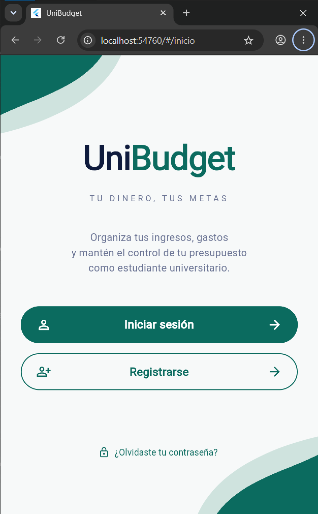

# Clase 23: Inventario y tokens

**Integrantes:** Sebastian Cespedes Rodas, Adolfo Mendoza Ribera  
**Modalidad:** sin IA

## 1. Inventario

Capturas de los botones y campos que se comportan distinto:

| Inicio: primario y secundario | Registro: primario |
|---|---|
|  |  |

| Cerrar sesión: diálogo | Editar límite: guardar |
|---|---|
|  |  |

Diferencias encontradas:

1. **Altura y radio:** los botones principales de Inicio/Registro son píldora y más altos; los de los diálogos son más bajos y con radio aproximado de 12.
2. **Contenido:** Inicio usa icono + texto + flecha; los diálogos usan solo texto.
3. **Relleno y borde:** el botón secundario de Inicio es contorneado; el primario es relleno verde. No hay una variante de peligro visible en las capturas.
4. **Estados:** se ven botones habilitados, pero no hay capturas de `loading` ni `disabled`; tampoco existe una variante `danger` en la interfaz actual.

## 2. Tokens

| Token | Claro | Oscuro | Dónde se usa |
|---|---|---|---|
| `color/primary` | `#0B6B5F` | `#7FE0C3` | Fondo de botones primarios y marca |
| `color/on-primary` | `#FFFFFF` | `#0B1F2A` | Texto e iconos sobre el primario |
| `color/text/primary` | `#0F1B3D` | `#F7F9F9` | Títulos y texto principal |
| `color/error` | `#D32F2F` | `#FF8A80` | Errores, eliminar y presupuesto excedido |
| `radius/pill` | `999` | `999` | Botones y campos tipo píldora |

Estos nombres coinciden con los roles usados en el código (`AppColors.primary`, `onPrimary`, `textPrimary`, `error` y `AppRadius.pill`). Los valores oscuros quedan propuestos para cuando se implemente el tema oscuro.

## 3. Colores fijos

**Pantalla revisada:** `lib/pantallas/pantalla_movimientos.dart`.

**Búsqueda realizada:** `Color(0x`, `Colors.` y `#` en el archivo.

**Resultado:** **16 referencias de color fijas** en esa pantalla. Ejemplos: `Colors.white`, `Colors.transparent`, `Colors.red.shade700`, `Colors.red`, `Color(0xFFFFE9C7)` y `Color(0xFF8A5A00)`.

No se corrigió el código durante la clase; solo se hizo el inventario y el conteo.

**Actualización posterior:** se migraron los colores fijos de `lib/` a `AppColors` y la búsqueda de `Color(0x...)`/`Colors.*` fuera de `app_tokens.dart` quedó en **0 referencias**. El sistema de componentes en Figma sigue siendo trabajo manual.
